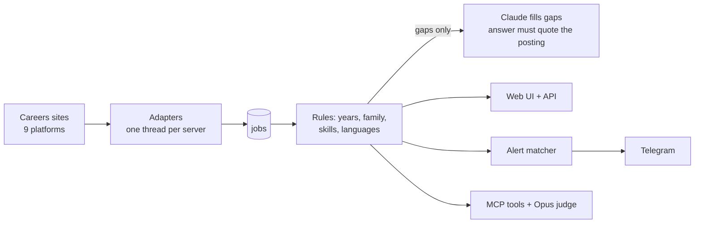

# JobRadar (job-agent)

A job-search app for the Indian tech market. It crawls live openings straight from the careers sites of large
companies (Amazon, Microsoft, JPMorgan, NVIDIA, Stripe, Atlassian, ...), works out what each job really asks for, and
helps you find, share and get referred for the ones worth applying to. You always click "apply" yourself.

**Live:** https://jobserver.tail8cf172.ts.net/ (sign up to use it)

**~6,700 open India jobs · 66 companies · 9 careers platforms · refreshed about every 30 minutes**

## Features

| Feature | What you get |
|---|---|
| **Job search** | Filter by job family, experience range, city or remote, skills, company and posting date, with live counts on every filter. |
| **Your profile** | Sign in, share your resume (Google Drive link or PDF) and the app reads your experience, skills and job families. "Match my resume" filters jobs to your level. |
| **Referrals** | Every job has a "Find connections" button (LinkedIn people search at that company) and a ready-to-copy referral message filled in from your profile. You can edit the wording. |
| **Telegram alerts** | Save an alert with the same filters as the search. New jobs that match it arrive on Telegram right after each crawl. |
| **AI search (MCP)** | In Claude, share your resume. The server shortlists jobs and Claude Opus marks each one APPLY / MAYBE / NO with a reason. |

## How it works



- **Crawling:** adapters for Workday, Eightfold, Oracle, Greenhouse, Lever, SmartRecruiters, Ashby, Amazon and
  Atlassian read the same JSON the companies' own careers pages use.
  - Polite by design: one request stream per server, slower when throttled, no bypassing of bot protection.
  - Job details are downloaded only for new or changed jobs, which saves 99% of requests.
  - Every crawl gets a health check. Jobs that disappear are closed.
- **Understanding jobs:** rules extract the experience range, job family, skills and main languages. Claude fills only
  what the rules miss, and an answer is kept only if its quote really appears in the posting. A daily job learns new
  skill names from the postings themselves (about 200 so far).
- **Alerts:** each new job is queued in the same database transaction that saves it. A poller matches it against
  everyone's saved filters in one SQL query, using the same rules as the website, and a sender delivers one Telegram
  message per user, with retries.

## Measured results

- **Full crawl:** 155 s instead of about 10 minutes, because stored job details are reused.
- **Search ranking:** nDCG@10 of 0.89 against an answer key the author confirmed by hand.
- **Tested and not adopted:** small local models, a cheaper judge (Haiku) and embeddings. Each was measured against
  that answer key and none beat the current approach.

## Tech stack

Java 21 · Spring Boot 4.1 · Spring Security (JWT + rotating refresh cookies) · Spring AI 2.0 (MCP server) · PostgreSQL
with Flyway and JdbcClient · React 19 + TypeScript + Vite + Tailwind 4 · Telegram Bot API (webhook) · 380 unit tests.

## Running it

Needs JDK 21+, Docker, Node 20+, and the Claude Code CLI for the AI parts.

```bash
docker run -d --name rag-postgres -e POSTGRES_PASSWORD=ragpass -p 5433:5432 postgres:18
docker exec rag-postgres psql -U postgres -c "CREATE DATABASE jobagent"
./mvnw spring-boot:run                                  # Flyway creates the schema and the company list
npm --prefix web install && npm --prefix web run dev    # http://localhost:5173
```

Every setting (crawl schedule, sign-up, Telegram bot, Claude models, ...) is listed in [CONFIGURATION.md](CONFIGURATION.md).

**Deploying:** a push to `main` runs the tests and builds on GitHub. A self-hosted runner on the home server then
swaps in the new version, checks its health, and rolls back if it does not come up.
